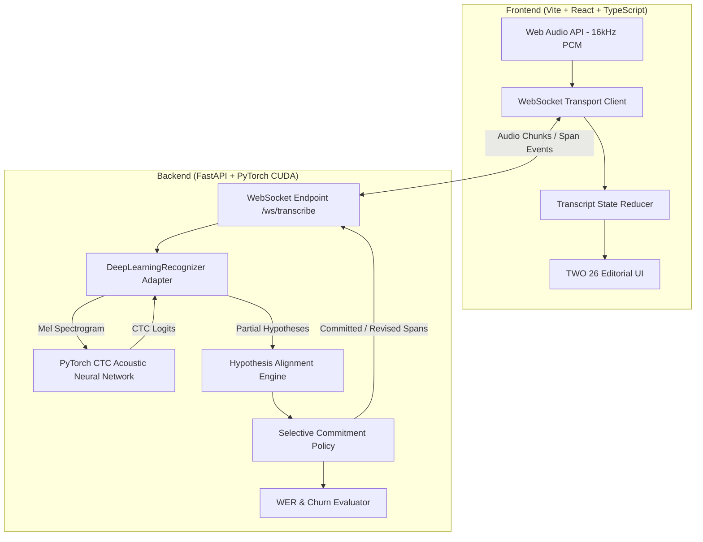

# TWO 26 • Selective Commitment Streaming Speech-to-Text (ASR)

A modern, real-time streaming speech-to-text platform featuring **Selective Commitment** to decouple provisional hypotheses from committed text, powered by an **on-device PyTorch CTC Deep Learning Acoustic Model** running on the GPU (NVIDIA RTX 3050) with a **TWO 26 studio editorial aesthetic**.

---

## 🎯 The Core Concept: Selective Commitment

In conventional streaming automatic speech recognition (ASR):
- **Eager commitment** causes severe visual flicker and churn when future acoustic context changes prior tokens.
- **Utterance-level delayed commitment** introduces high latency, forcing the user to wait until pauses before seeing stable text.
- **Monotonic fixed-lag** commits blindly by word count regardless of confidence or stability.

**Selective Commitment** solves this:
1. **Provisional Spans**: Remain visibly distinct (editable, dashed amber/orange) and can be revised when new acoustic evidence arrives.
2. **Selective Commitment**: Spans lock in and turn permanent (**committed**) once they achieve stability across $K$ consecutive partial hypotheses or reach a latency deadline.
3. **Non-blocking Stream**: Downstream speech continues to be transcribed even while earlier spans remain provisional.
4. **Isolate Revisions**: Corrections update only the affected provisional token without disrupting preceding stable text.

---

## 🏗️ System Architecture



---

## 🧠 Deep Learning Architecture & Training

The recognition pipeline runs on-device using pure PyTorch on CUDA (NVIDIA GeForce RTX 3050 Laptop GPU):

1. **Feature Extraction**: Pure PyTorch STFT converting raw 16 kHz audio into 80-dimensional triangular Log-Mel spectrograms.
2. **Convolutional Front-End**: 1D Convolutions with kernel size 3, stride 2, BatchNorm1d, and GELU activations for temporal subsampling.
3. **Recurrent Encoder**: 3-layer Bidirectional LSTM ($512$ hidden units) with LayerNorm and Dropout ($0.20$).
4. **Classification Head**: Linear projection to character vocabulary logits (Blank $= 0$, Space $= 1$, `'`, a–z).
5. **Loss & Training**: `nn.CTCLoss(blank=0, zero_infinity=True)` optimized via `AdamW`.

### Training the Model
To train or fine-tune the CTC acoustic model on your local GPU:
```powershell
cd backend
venv\Scripts\python.exe -m app.ml.train
```
Checkpoints are automatically saved to `backend/app/ml/checkpoints/model.pt`.

---

## 🎨 Visual Identity: TWO 26 Studio Aesthetic

The application is styled with the bold, high-contrast **TWO 26 studio editorial aesthetic**:
- **Canvas Palette**: Warm pastel peach-cream (`#faeee7`).
- **Signature Accent**: Electric warm studio orange (`#ff4800` / `#ff5500`).
- **Ink-Black Elements**: Deep charcoal (`#121212`) cards with neo-brutalist offset drop shadows (`3px 3px 0px #121212`).
- **Typography**: Ultra-bold display font (`Syne 900`) for headers and `Plus Jakarta Sans` for clean editorial UI copy.
- **Floating Stickers**: Rotated pill tags (`-6°` and `+4°`) highlighting key capabilities.
- **Accessible State Differentiation**:
  - 🟢 **Committed Spans**: Solid ink-black text with bold baseline indicator.
  - 🟡 **Provisional Spans**: Electric orange text with warm peach pillow backgrounds (`#ffebe3`) and dashed borders.
  - 🟣 **Revised Spans**: Vivid purple correction tags with micro-bounce animations (`↺1`).

---

## 🚀 Quickstart Guide

### 1. Prerequisites
- **Python 3.13** (with NVIDIA GPU & CUDA 12.4+ recommended)
- **Node.js 22+** and **npm**

### 2. Backend Setup (FastAPI + PyTorch)
```powershell
cd backend
python -m venv venv
venv\Scripts\activate
pip install -r requirements.txt
uvicorn app.main:app --host 127.0.0.1 --port 8000
```
- **Health Check**: `http://127.0.0.1:8000/health`
- **WebSocket Streaming**: `ws://127.0.0.1:8000/ws/transcribe`
- **Replay Scorer**: `POST http://127.0.0.1:8000/api/replay`

### 3. Frontend Setup (Vite + React)
```powershell
cd frontend
npm install
npm run dev
```
Open **[http://localhost:5173/](http://localhost:5173/)** in your browser.

---

## 🧪 Testing & Evaluation

Run the automated backend test suite:
```powershell
backend\venv\Scripts\python -m pytest backend\tests -v
```

For complete step-by-step procedures covering:
- On-device GPU streaming verification
- Offline benchmark evaluations (0% WER target)
- Mock streaming revision transitions
- Edge cases and microphone error handling

Please refer to [`testing.md`](testing.md).

---

## 📁 Repository Structure

```text
├── backend/
│   ├── app/
│   │   ├── adapters/            # Recognizer adapters (DeepLearning, Mock, AWS)
│   │   ├── core/                # Alignment algorithm, Policy engine, Session manager
│   │   ├── metrics/             # Levenshtein WER scorer and text normalizer
│   │   ├── ml/                  # PyTorch model architecture, vocabulary, train.py
│   │   ├── models/              # Pydantic schemas (spans, events, policies)
│   │   └── main.py              # FastAPI server & WebSocket routes
│   ├── tests/                   # Pytest suite
│   └── requirements.txt
├── frontend/
│   ├── src/
│   │   ├── audio/               # Web Audio API 16kHz PCM capture
│   │   ├── components/          # Controls, Live Transcript, Metrics Panel
│   │   ├── index.css            # TWO 26 design system tokens
│   │   └── App.tsx              # Application layout & WebSocket client
│   ├── package.json
│   └── vite.config.ts
├── testing.md                   # Comprehensive testing & verification guide
├── plan.md                      # Engineering manifesto & requirements
└── README.md
```

---

## 📜 License
MIT License.